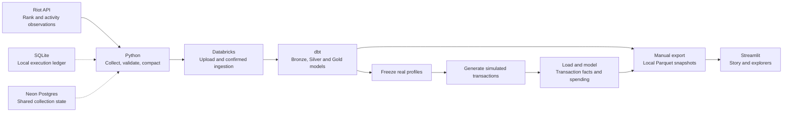

# players-as-customers-pipeline

**A data pipeline connecting user behavior to customer questions.**

Understanding what users prefer, how their interests change and which audiences overlap can inform content and marketing decisions. This project turns repeated observations into inspectable histories, audience profiles and an interactive dashboard.

Behavioral observations come from Riot's League of Legends API: competitive rank and character activity. **Purchase history is simulated**: generated events join a frozen set of eligible real profiles to demonstrate how a commercial source could extend the analysis.

**[Try locally](#try-the-dashboard) · [Inspect the engineering](#inspect-the-implementation) · [Read the design decisions](docs/wiki/engineering-decisions.md)**

## Try the dashboard

The included Streamlit app runs from local Parquet snapshots without a Riot API key, Neon account or Databricks credentials. From the repository root, in a Python environment:

```sh
python -m pip install -r streamlit_app/requirements.txt
python -m streamlit run streamlit_app/app.py
```

Start with **The story** for the case study, then use **Explore the data** to compare recent preferences with accumulated history, inspect shared character audiences or examine the simulated business scenario. English and Brazilian Portuguese are supported. The [dashboard guide](docs/guides/run-the-dashboard.md) covers environment setup, navigation and troubleshooting.

The bundled snapshot contains **37,172 profiles**, as of **September 29, 2026**, exported **October 10, 2026**. The [manifest](streamlit_app/data/manifest.json) records dataset dates and scenario provenance. These files stay frozen until a new manual export.

## How data reaches the dashboard



Python coordinates collection through a separate ingestion job and dbt build. SQLite records local work and files, Neon holds shared collection progress, and Databricks retains analytical history. A manual export separates dashboard viewing from warehouse availability. The [architecture chapter](docs/wiki/architecture.md) explains the full flow and its boundaries.

## Inspect the implementation

| Engineering problem | Implemented decision | Inspect |
|---|---|---|
| Work within a source request budget | Discover players through rank listings, synchronize request pacing and adapt the refresh allocation. | [Runner](src/extract/run_pipeline.py) · [API client](src/extract/api_client.py) |
| Explain partial work and confirmed delivery | Keep local file lineage and shared collection progress separate; confirm ingestion before advancing delivery-related state. | [Ledger](src/extract/extraction_schemas.sql) · [Registry](src/load/player_registry.py) · [Loader](src/load/load_compacted_to_databricks.py) |
| Distinguish accumulated behavior from observed change | Keep dated history, actual observation endpoints, clear counting units and eligibility rules. | [Models](league_pipeline/models) · [Model tests](league_pipeline/tests) |
| Demonstrate a transaction integration | Freeze real profiles, generate events and reconcile scenario identities, event counts and cash totals. | [Generator](src/sample/generate_transactions.py) · [Validation](src/sample/validation.py) |
| Deliver an accessible result | Remove operational identifiers and serve checked local Parquet snapshots. | [Exporter](streamlit_app/scripts/export_data.py) · [Public contracts](streamlit_app/app_core/contracts.py) |

Tests cover selected execution boundaries, analytical methods and serving contracts. [Validation and evidence](docs/reference/validation-and-evidence.md) records the scope of local checks and dated warehouse builds; it distinguishes those records from live recovery and performance claims.

## Scope and evidence

The character activity score, called mastery in the app, covers several game modes and does not directly measure matches or hours. Preferred characters and roles are inferred. Audience and rank comparisons describe selected cohorts; adjusting their rank mix does not remove every selection bias or establish that a behavior causes improvement.

The transaction scenario demonstrates integration and analytical consistency. Its spending relationships are deliberately configured, so they cannot establish actual demand, revenue or return on investment. [Understanding the analysis](docs/wiki/understanding-the-analysis.md) explains how to read the comparisons.

The core pipeline and local dashboard are implemented. Execution is operator-started and snapshot exports are manual. Dashboard presentation is being refined; public hosting is planned.

## Read more

The [documentation index](docs/README.md) organizes wiki chapters, practical guides and technical references by task. Operators can start with [run the pipeline](docs/guides/run-the-pipeline.md) or [refresh dashboard data](docs/guides/refresh-dashboard-data.md).

Earlier documents remain in the [archive](docs/deprecated/README.md).

## Author and attribution

Built by **Pedro Iaki**. AI assisted review and implementation; architecture, decisions and final review remained mine. AI generation was concentrated in dashboard prototyping and frontend work.

[Contact on LinkedIn](https://linkedin.com/in/iaki/) · [Source repository](https://github.com/Pedro-Iaki/league-specialization-etl) · [MIT License](LICENSE)

This independent project uses Riot API services and is not affiliated with or endorsed by Riot Games. League of Legends and Riot Games names belong to their respective owners.
