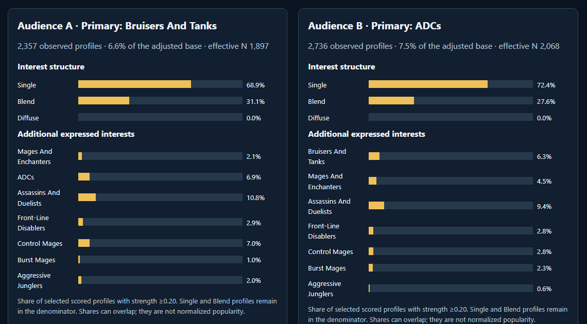
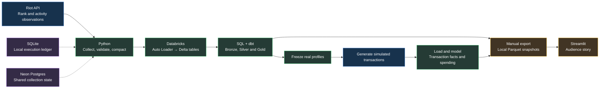

<div align="center">

# Players as Customers

**An end-to-end data engineering portfolio: from user behavior to audience and customer questions.**

<p>
  
  
  
  
  
  
  <a href="LICENSE"></a>
</p>

**[Open the live dashboard](https://players-as-customers-pipeline.streamlit.app)** · **[Run locally](#quick-start)** · **[Contact Pedro](https://linkedin.com/in/iaki/)**

Available in English and Brazilian Portuguese

**[Architecture](#architecture)** · **[Engineering decisions](#engineering-decisions)** · **[Understanding the analysis](#understanding-the-analysis)** · **[Evidence](#validation-and-evidence)** · **[Full documentation](docs/README.md)**

</div>

---

## Overview

Which behavioral patterns define useful audiences, and what could those audiences tell us about content and marketing opportunities? **Players as Customers** turns repeated user observations into dated histories, reusable audience definitions and an interactive comparison dashboard.

I built the project from source collection through warehouse modeling and delivery. Its engineering work centers on a constrained API budget, persistent execution state, historical SQL models, validation at delivery boundaries and an output that reviewers can explore independently of the pipeline.

The behavioral source is Riot's League of Legends API, which exposes competitive rank and cumulative character activity. Repeated snapshots help distinguish accumulated preferences from current interests. **Purchase history is simulated**, joined to a frozen set of real profiles to demonstrate a separate commercial integration.

| Behavioral profiles | Profiles with archetype scores | Character-interest families | Player archetypes |
|:---:|:---:|:---:|:---:|
| **38,403** | **13,348** | **25 overlapping groups** | **8 mixture components** |

*Behavioral snapshot: October 20, 2026. Archetype scoring covers eligible profiles; family and component counts describe the accepted definitions. [Coverage and evidence](docs/reference/validation-and-evidence.md).*

**[Explore the live dashboard](https://players-as-customers-pipeline.streamlit.app)** to compare activity, standing and interests, build two audiences, and carry their filters into simulated purchase reporting. It opens in Portuguese; choose English in the header. Viewing requires no pipeline credentials.

[](https://players-as-customers-pipeline.streamlit.app)

*English view of the Interests chapter: two audiences defined by their primary character interests, with their preference mixtures and additional interests. Saved definitions, diagnostics and engineering evidence are available in the dashboard.*

## Architecture



| Technology | Responsibility in this project |
|---|---|
| **Python** | API collection, synchronized request pacing, discovery/refresh allocation, validation and ordered pipeline stages. |
| **SQL + dbt** | Source deduplication, incremental history, analytical facts and marts, and schema/business-rule tests. |
| **Databricks + Delta Lake** | Parquet landing, checkpointed Auto Loader ingestion into raw Delta tables, and separate ingestion/build jobs. |
| **PostgreSQL / Neon + SQLite** | Shared freshness, work claims and discovery progress in Neon; local task outcomes and file lineage in SQLite. |
| **Parquet + Streamlit** | Manually exported, validated snapshots; Python audience queries and a bilingual interactive dashboard. |

The loader confirms ingestion before advancing delivery-related state. A separate dbt job builds the analytical layers; manual export and review prepare the serving snapshots. The hosted dashboard reads those bundled files, so browsing does not query the warehouse or start collection.

The **[architecture chapter](docs/wiki/architecture.md)** follows the decisions and gates in detail. The **[data-model reference](docs/reference/data-models.md)** maps the layers to models, grains and serving datasets.

## Engineering decisions

The implementation makes source constraints, history and partial delivery explicit. These are the main decisions to inspect in a technical review:

| Engineering problem | Implemented decision | Inspect |
|---|---|---|
| Spend API requests on repeated coverage | Collect rank listings and character-activity snapshots; balance discovery with stale-profile refresh under synchronized request pacing. This trades match-level detail for broader behavioral coverage. | [Runner](src/extract/run_pipeline.py) · [API client](src/extract/api_client.py) |
| Explain partial work and confirmed delivery | Keep local file lineage and shared collection progress separate; confirm ingestion before advancing delivery-related state. | [Ledger](src/extract/extraction_schemas.sql) · [Registry](src/load/player_registry.py) · [Loader](src/load/load_compacted_to_databricks.py) |
| Preserve usable history as observations arrive | Use incremental Delta merges, source-date deduplication and a late-arrival lookback; derive changes from actual observation endpoints with eligibility checks. | [Player history](league_pipeline/models/silver/players/dim_players_history.sql) · [Period facts](league_pipeline/models/gold/fct_players_rank_periods.sql) · [SQL checks](league_pipeline/tests) |
| Turn overlapping preferences into reproducible audience slices | Separate exploratory family discovery from versioned memberships and fixed player-archetype inference. | [Accepted families](docs/reference/character-family-cohort.md) · [Frozen archetypes](docs/reference/player-pool-archetypes.md) |
| Demonstrate a transaction integration | Freeze real profiles, generate events and reconcile scenario identities, event counts and cash totals. | [Generator](src/sample/generate_transactions.py) · [Validation](src/sample/validation.py) |
| Deliver an accessible result | Remove operational identifiers and serve checked local Parquet snapshots. | [Exporter](streamlit_app/scripts/export_data.py) · [Public contracts](streamlit_app/app_core/contracts.py) |

I kept orchestration in a bounded Python workflow and serving in exported snapshots to match periodic operation. The tradeoff is explicit operator involvement in runs, recovery and refresh. **[Engineering decisions](docs/wiki/engineering-decisions.md)** explains the alternatives, development lessons and remaining limits.

## Understanding the analysis

The analysis progresses from **activity → competitive standing → interests → audience construction → simulated purchases**. It keeps accumulated activity, current preferences and observed changes separate so each comparison has a clear meaning.

Two analytical layers turn character choices into reusable audience definitions:

1. **Character-interest groups:** shared character audiences informed graph clustering with Leiden, resampling diagnostics and member-level review. The accepted **25 overlapping champion families** allow a character to belong to several groups.
2. **Player preference mixtures:** nonnegative matrix factorization (**NMF**) over family affinities produced **eight player archetypes**. A person can express several interests. Versioned definitions and fixed inference keep routine exports consistent without refitting the model for each audience.

The dashboard uses these definitions to compare audiences' activity and standing, inspect their overlap, and apply the same filters to the simulated customer cohort. Saved family diagnostics and component explanations make the definitions inspectable. Their prevalence is not a fair popularity ranking, and observed differences do not establish causal effects or real commercial demand.

Read **[Understanding the analysis](docs/wiki/understanding-the-analysis.md)** for the reasoning, **[champion families](docs/reference/character-family-cohort.md)** and **[player archetypes](docs/reference/player-pool-archetypes.md)** for the accepted methods, and **[simulated transactions](docs/wiki/simulated-transactions.md)** for the commercial demonstration.

## Validation and evidence

Validation follows the boundaries where data or responsibility changes:

- **Execution and delivery:** configuration, local integrity and ingestion-confirmation checks gate progress; [boundary tests](src/extract/tests/test_load_boundaries.py) exercise selected failure paths with mocked services.
- **Models and generated transactions:** [dbt tests](league_pipeline/tests) check analytical contracts, while [scenario validation](src/sample/validation.py) reconciles identities, event counts and cash totals.
- **Serving:** [public contracts](streamlit_app/app_core/contracts.py) reject operational identifiers and invalid extracts; the [story manifest](streamlit_app/data/story/manifest.json) records the current package's dates, inventory and scenario provenance.

The commercial scenario contains **24,990 members** frozen at **September 29, 2026**, separately from the October behavioral snapshot. Recorded checks cover fixed-model inference, identity-safe linkage, audience denominators, scenario reconciliation and actual browser interactions. The dashboard includes sanitized timelines from two recorded pipeline runs and a file-lineage example.

Those checks have limits: mocked failures do not prove live recovery, rank adjustment does not remove all selection bias, and configured spending patterns do not establish real commercial results. Read **[Validation and evidence](docs/reference/validation-and-evidence.md)** for the exact scopes, dates and remaining evidence gaps.

## Quick start

Use the **[hosted dashboard](https://players-as-customers-pipeline.streamlit.app)** to explore immediately, or run the bundled snapshots locally. Clone or download this repository, then run the commands below from its root. The dashboard has been verified locally with **Python 3.11**; create the virtual environment only if needed.

<details open>
<summary><strong>Windows · PowerShell</strong></summary>

```powershell
python -m venv .venv
.\.venv\Scripts\python.exe -m pip install -r streamlit_app/requirements.txt
.\.venv\Scripts\python.exe -m streamlit run streamlit_app/app.py
```

</details>

<details>
<summary><strong>macOS / Linux</strong></summary>

```sh
python3 -m venv .venv
.venv/bin/python -m pip install -r streamlit_app/requirements.txt
.venv/bin/python -m streamlit run streamlit_app/app.py
```

</details>

Open the local URL printed by Streamlit. The bundled data requires **no API keys or warehouse credentials**. The [launch guide](docs/guides/run-the-dashboard.md) covers environment details, navigation and troubleshooting.

Operating the source pipeline requires credentials, prepared services and adapted job configuration; installation into a newly provisioned environment has not been verified. Use **[Run the pipeline](docs/guides/run-the-pipeline.md)** for setup and **[Refresh dashboard data](docs/guides/refresh-dashboard-data.md)** for manual export and snapshot review. The **[documentation index](docs/README.md)** routes deeper questions to the explanatory chapters, operating guides and exact contracts.

## Author and attribution

Built by **Pedro Iaki** as a solo portfolio project.

[](https://linkedin.com/in/iaki/)
[](https://github.com/Pedro-Iaki/league-specialization-etl)

Released under the [MIT License](LICENSE).

This independent project uses Riot API services and is not affiliated with or endorsed by Riot Games. League of Legends and Riot Games names belong to their respective owners.
