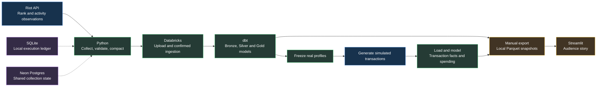

<div align="center">

# Players as Customers

**A data pipeline connecting user behavior to customer questions.**

<p>
  
  
  
  
  
  <a href="LICENSE"></a>
</p>

**[Run the dashboard](#quick-start)** · **[Architecture](#architecture)** · **[Engineering decisions](#engineering-decisions)** · **[Evidence](#validation-and-evidence)** · **[Documentation](docs/README.md)**

Brazilian Portuguese & English · Local snapshot serving · Real behavior + simulated purchases

</div>

---

## Overview

Customer and content decisions depend on understanding what users prefer, how their interests change and which audiences overlap. This project turns repeated behavioral observations into dated histories, audience profiles and an interactive dashboard. Keeping accumulated activity, current interests and observed outcomes separate makes those comparisons interpretable.

Behavioral observations come from Riot's League of Legends API: competitive rank and character activity. **Purchase history is simulated**: generated events join a frozen set of eligible real profiles to demonstrate how a commercial source could extend the analysis.

**[Explore the dashboard locally](docs/guides/run-the-dashboard.md)** using the bundled snapshots, without pipeline credentials. It opens in Portuguese, with English available in the header.

| Behavioral profiles | Scored player profiles | Champion families | Player archetypes |
|:---:|:---:|:---:|:---:|
| **38,403** | **13,348** | **25 overlapping groups** | **8 mixture components** |

*Behavioral snapshot: October 20, 2026. [Definitions, coverage and evidence](docs/reference/validation-and-evidence.md).*

> **Follow the story:** Activity → Standing → Interests → Build an audience → Simulated purchases → Engineering evidence.

To follow the reasoning, read **[Understanding the analysis](docs/wiki/understanding-the-analysis.md)** → **[Architecture](docs/wiki/architecture.md)** → **[Engineering decisions](docs/wiki/engineering-decisions.md)**. The [documentation index](docs/README.md) provides optional operating guides and exact contracts.

## Quick start

From the repository root, create a virtual environment if needed. The dashboard has been verified locally with **Python 3.11**.

<details open>
<summary><strong>Windows · PowerShell</strong></summary>

```powershell
python -m venv .venv
.\.venv\Scripts\python.exe -m pip install -r streamlit_app/requirements.txt
.\.venv\Scripts\python.exe -m streamlit run streamlit_app/app.py
```

</details>

<details>
<summary><strong>macOS / Linux</strong></summary>

```sh
python3 -m venv .venv
.venv/bin/python -m pip install -r streamlit_app/requirements.txt
.venv/bin/python -m streamlit run streamlit_app/app.py
```

</details>

Open the local URL printed by Streamlit. The bundled data requires **no API keys or warehouse credentials**. See the [launch guide](docs/guides/run-the-dashboard.md) for environment details and troubleshooting.

## Understanding the analysis

Repeated observations help distinguish an old favorite from a current interest. The dashboard first separates accumulated play, competitive frequency and retained history, then adds standing and character preferences. These dimensions describe different aspects of an audience.

Shared character audiences became **25 overlapping champion families**, selected using graph clustering, resampling diagnostics and member-level review. Players' affinities across those families then became **eight frozen NMF archetypes**. Players can express mixtures; a single favorite or an exclusive type would lose that detail. The accepted definitions and saved evidence are inspectable through the dashboard.

Archetypes act as audience slicers: compare activity and standing, combine conditions, then inspect the same selection's simulated purchasing. Their prevalence is not a fair popularity ranking, and observed differences do not establish causal effects. The commercial branch demonstrates integration and reporting over generated outcomes, without claiming actual customer demand.

[Understanding the analysis](docs/wiki/understanding-the-analysis.md) follows this progression and its limits. [Simulated transactions](docs/wiki/simulated-transactions.md) explains the additional commercial source.

## Architecture



<details>
<summary><strong>How data moves and which system owns each responsibility</strong></summary>

The Python coordinator uses shared freshness and discovery progress to balance ranked-page discovery with refreshing stale profiles. Both paths collect new dated observations. SQLite records local tasks and file lineage; Neon holds shared freshness, work claims and page progress; Databricks retains analytical observations and history.

At delivery boundaries, integrity checks and compaction prepare the load inputs. Upload is followed by confirmed ingestion before delivery-related state advances; a separate dbt job then builds the analytical models. Manual export produces the dashboard's local Parquet snapshots, keeping viewing independent of warehouse availability.

Bronze resolves repeated source-date observations, Silver retains normalized history and current state, and Gold derives profiles, eligible periods and audience summaries. The generated transaction branch adds its own facts and spending summaries.

</details>

The **[architecture chapter](docs/wiki/architecture.md)** follows the decisions and gates in detail. The **[data-model reference](docs/reference/data-models.md)** maps the layers to models, grains and serving datasets.

## Engineering decisions

The design spends a constrained request budget on repeated behavioral coverage, retains the history needed for comparisons, and makes partial delivery explainable. A bounded Python coordinator keeps stage order explicit; local snapshot serving makes the result accessible at the cost of a manual refresh.

| Engineering problem | Implemented decision | Inspect |
|---|---|---|
| Work within a source request budget | Discover players through rank listings, synchronize request pacing and adapt the refresh allocation. | [Runner](src/extract/run_pipeline.py) · [API client](src/extract/api_client.py) |
| Explain partial work and confirmed delivery | Keep local file lineage and shared collection progress separate; confirm ingestion before advancing delivery-related state. | [Ledger](src/extract/extraction_schemas.sql) · [Registry](src/load/player_registry.py) · [Loader](src/load/load_compacted_to_databricks.py) |
| Distinguish accumulated behavior from observed change | Keep dated history, actual observation endpoints, clear counting units and eligibility rules. | [Models](league_pipeline/models) · [Model tests](league_pipeline/tests) |
| Turn overlapping preferences into reproducible audience slices | Separate exploratory family discovery from versioned memberships and fixed player-archetype inference. | [Accepted families](docs/reference/character-family-cohort.md) · [Frozen archetypes](docs/reference/player-pool-archetypes.md) |
| Demonstrate a transaction integration | Freeze real profiles, generate events and reconcile scenario identities, event counts and cash totals. | [Generator](src/sample/generate_transactions.py) · [Validation](src/sample/validation.py) |
| Deliver an accessible result | Remove operational identifiers and serve checked local Parquet snapshots. | [Exporter](streamlit_app/scripts/export_data.py) · [Public contracts](streamlit_app/app_core/contracts.py) |

Read **[Engineering decisions](docs/wiki/engineering-decisions.md)** for the rationale, alternatives, limitations and development lessons behind these mechanisms.

## Validation and evidence

Validation follows the boundaries where data or responsibility changes:

- **Execution and delivery:** configuration, local integrity and ingestion-confirmation checks gate progress; [boundary tests](src/extract/tests/test_load_boundaries.py) exercise selected failure paths with mocked services.
- **Models and generated transactions:** [dbt tests](league_pipeline/tests) check analytical contracts, while [scenario validation](src/sample/validation.py) reconciles identities, event counts and cash totals.
- **Serving:** [public contracts](streamlit_app/app_core/contracts.py) reject operational identifiers and invalid extracts; the [story manifest](streamlit_app/data/story/manifest.json) records the current package's dates, inventory and scenario provenance.

The commercial scenario contains **24,990 members** and remains frozen at **September 29, 2026**, separately from the October behavioral snapshot. Recorded verification covers fixed-model application, identity-safe linkage, audience denominators, scenario reconciliation and browser interactions. Sanitized execution timelines and lineage examples expose separate evidence of actual pipeline runs.

Those checks have limits: mocked failures do not prove live recovery, rank adjustment does not remove all selection bias, and configured spending patterns do not establish real commercial results. Read **[Validation and evidence](docs/reference/validation-and-evidence.md)** for the exact scopes, dates and remaining evidence gaps.

## Explore the result or reproduce it

The default Streamlit interface follows a seven-chapter audience story: purpose, activity, standing, interests, audience construction, simulated purchases, and engineering evidence. It includes the eight frozen player-pool archetypes, an interactive shared/A/B audience builder, linked architecture diagrams, saved family diagnostics and recorded execution summaries. Viewing requires only bundled local snapshots; Python returns aggregates through a bundled Streamlit component. The interface opens in Brazilian Portuguese, with English available from the header language selector. The previous dashboard, explorers, laboratories and their EN/PT support remain available through `streamlit_app/legacy_app.py`. Public hosting remains planned. **[Run the bundled dashboard](docs/guides/run-the-dashboard.md)** for launch instructions.

Operating the source pipeline requires credentials, manually prepared services and adapted job configuration. **[Run the pipeline](docs/guides/run-the-pipeline.md)** details those prerequisites and the first-build sequence; installation into a newly provisioned environment has not been verified. **[Refresh dashboard data](docs/guides/refresh-dashboard-data.md)** covers the separate manual export and snapshot review. The **[documentation index](docs/README.md)** routes more specific questions to their guides and contracts.

## Author and attribution

Built by **Pedro Iaki**. AI assisted review and implementation; architecture, decisions and final review remained mine. AI generation was concentrated in dashboard prototyping and frontend work.

[](https://linkedin.com/in/iaki/)
[](https://github.com/Pedro-Iaki/league-specialization-etl)

Released under the [MIT License](LICENSE).

This independent project uses Riot API services and is not affiliated with or endorsed by Riot Games. League of Legends and Riot Games names belong to their respective owners.
