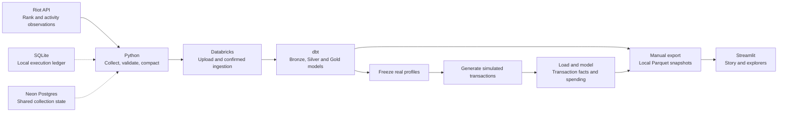

# players-as-customers-pipeline

**A data pipeline connecting user behavior to customer questions.**

Customer and content decisions depend on understanding what users prefer, how their interests change and which audiences overlap. This project turns repeated behavioral observations into dated histories, audience profiles and an interactive dashboard. Keeping accumulated activity, current interests and observed outcomes separate makes those comparisons interpretable.

Behavioral observations come from Riot's League of Legends API: competitive rank and character activity. **Purchase history is simulated**: generated events join a frozen set of eligible real profiles to demonstrate how a commercial source could extend the analysis.

- **[Architecture](docs/wiki/architecture.md)** — Follow collection decisions, state ownership, integrity gates and delivery through to the dashboard.
- **[Engineering decisions](docs/wiki/engineering-decisions.md)** — Examine the tradeoffs behind source selection, history, coordination and snapshot serving.
- **[Validation and evidence](docs/reference/validation-and-evidence.md)** — Inspect the checks, public artifacts, dated results and limits of demonstrated behavior.
- **[Understanding the analysis](docs/wiki/understanding-the-analysis.md)** — See how audience questions become measurements, comparisons and qualified interpretations.

The **[full documentation index](docs/README.md)** provides task-based routes to explanations, reproduction guides and exact technical contracts.

## Understanding the analysis

Repeated observations make it possible to distinguish an old favorite from a current interest. The analysis builds on that distinction to investigate three questions:

- **What defines an audience?** Character breadth, activity concentration and inferred recent preferences describe different aspects of behavior. Interpretable SQL rules summarize these features into profile groups.
- **How do audiences differ?** Rank, accumulated experience and eligible observed outcomes provide comparison dimensions. Sample summaries, rank-weighted estimates and comparisons at a common rank mix answer different questions.
- **Which audiences overlap?** Shared character preferences and directional overlap reveal related interests. Overlap relative to audience size helps distinguish common characters from unusually strong associations.

The commercial branch joins frozen real profiles to simulated purchases to demonstrate spending and audience comparisons. Each comparison needs an explicit cohort, time window and denominator; missing follow-up remains missing. Activity scores cover several game modes, and character-specific competitive outcomes are inferred. These observations support audience hypotheses, without establishing causal improvement or actual customer demand.

Read **[Understanding the analysis](docs/wiki/understanding-the-analysis.md)** for the reasoning, **[Simulated transactions](docs/wiki/simulated-transactions.md)** for the commercial scenario, and **[Metrics and methods](docs/reference/metrics-and-methods.md)** for definitions.

## Architecture

The Python coordinator uses shared freshness and discovery progress to balance ranked-page discovery with refreshing stale profiles. Both paths collect new dated observations. SQLite records local tasks and file lineage; Neon holds shared freshness, work claims and page progress; Databricks retains analytical observations and history.

At delivery boundaries, integrity checks and compaction prepare the load inputs. Upload is followed by confirmed ingestion before delivery-related state advances; a separate dbt job then builds the analytical models. Manual export produces the dashboard's local Parquet snapshots, keeping viewing independent of warehouse availability.

Bronze resolves repeated source-date observations, Silver retains normalized history and current state, and Gold derives profiles, eligible periods and audience summaries. The generated transaction branch adds its own facts and spending summaries.

The **[architecture chapter](docs/wiki/architecture.md)** follows the decisions and gates in detail. The **[data-model reference](docs/reference/data-models.md)** maps the layers to models, grains and serving datasets.

## Engineering decisions

The design spends a constrained request budget on repeated behavioral coverage, retains the history needed for comparisons, and makes partial delivery explainable. A bounded Python coordinator keeps stage order explicit; local snapshot serving makes the result accessible at the cost of a manual refresh.

| Engineering problem | Implemented decision | Inspect |
|---|---|---|
| Work within a source request budget | Discover players through rank listings, synchronize request pacing and adapt the refresh allocation. | [Runner](src/extract/run_pipeline.py) · [API client](src/extract/api_client.py) |
| Explain partial work and confirmed delivery | Keep local file lineage and shared collection progress separate; confirm ingestion before advancing delivery-related state. | [Ledger](src/extract/extraction_schemas.sql) · [Registry](src/load/player_registry.py) · [Loader](src/load/load_compacted_to_databricks.py) |
| Distinguish accumulated behavior from observed change | Keep dated history, actual observation endpoints, clear counting units and eligibility rules. | [Models](league_pipeline/models) · [Model tests](league_pipeline/tests) |
| Demonstrate a transaction integration | Freeze real profiles, generate events and reconcile scenario identities, event counts and cash totals. | [Generator](src/sample/generate_transactions.py) · [Validation](src/sample/validation.py) |
| Deliver an accessible result | Remove operational identifiers and serve checked local Parquet snapshots. | [Exporter](streamlit_app/scripts/export_data.py) · [Public contracts](streamlit_app/app_core/contracts.py) |

Read **[Engineering decisions](docs/wiki/engineering-decisions.md)** for the rationale, alternatives, limitations and development lessons behind these mechanisms.

## Validation and evidence

Validation follows the boundaries where data or responsibility changes:

- **Execution and delivery:** configuration, local integrity and ingestion-confirmation checks gate progress; [boundary tests](src/extract/tests/test_load_boundaries.py) exercise selected failure paths with mocked services.
- **Models and generated transactions:** [dbt tests](league_pipeline/tests) check analytical contracts, while [scenario validation](src/sample/validation.py) reconciles identities, event counts and cash totals.
- **Serving:** [public contracts](streamlit_app/app_core/contracts.py) reject operational identifiers and invalid extracts; the [manifest](streamlit_app/data/manifest.json) records dates, inventory and scenario provenance.

The legacy export has **13 datasets**, including **38,403 profile rows** as of **October 20, 2026**, exported **October 23, 2026**. The simulated transaction scenario remains frozen at **September 29, 2026**. Local checks cover family scoring, coherent snapshot contracts, audience denominators, synthetic cash reconciliation and the legacy six guided chapters. The new default story ships a separate archetype-enriched profile/customer package with the same behavioral base and frozen scenario. The evidence reference also records dated historical warehouse builds, separately from inspectable public artifacts and local tests.

Those checks have limits: mocked failures do not prove live recovery, rank adjustment does not remove all selection bias, and configured spending patterns do not establish real commercial results. Read **[Validation and evidence](docs/reference/validation-and-evidence.md)** for the exact scopes, dates and remaining evidence gaps.

## Explore the result or reproduce it

The default Streamlit interface follows a seven-chapter audience story: purpose, activity, standing, interests, audience construction, simulated purchases, and engineering evidence. It includes the eight frozen player-pool archetypes, an interactive shared/A/B audience builder, linked architecture diagrams, saved family diagnostics and recorded execution summaries. Viewing requires only bundled local snapshots; Python returns aggregates through a bundled Streamlit component. The interface opens in Brazilian Portuguese, with English available from the header language selector. The previous dashboard, explorers, laboratories and their EN/PT support remain available through `streamlit_app/legacy_app.py`. Public hosting remains planned. **[Run the bundled dashboard](docs/guides/run-the-dashboard.md)** for launch instructions.

Operating the source pipeline requires credentials, manually prepared services and adapted job configuration. **[Run the pipeline](docs/guides/run-the-pipeline.md)** details those prerequisites and the first-build sequence; installation into a newly provisioned environment has not been verified. **[Refresh dashboard data](docs/guides/refresh-dashboard-data.md)** covers the separate manual export and snapshot review. The **[documentation index](docs/README.md)** routes more specific questions to their guides and contracts.

## Author and attribution

Built by **Pedro Iaki**. AI assisted review and implementation; architecture, decisions and final review remained mine. AI generation was concentrated in dashboard prototyping and frontend work.

[Contact on LinkedIn](https://linkedin.com/in/iaki/) · [Source repository](https://github.com/Pedro-Iaki/league-specialization-etl) · [MIT License](LICENSE)

This independent project uses Riot API services and is not affiliated with or endorsed by Riot Games. League of Legends and Riot Games names belong to their respective owners.
