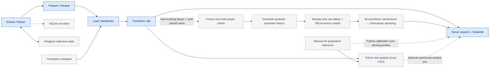

# League Specialization ETL

How does concentrating play on a smaller set of champions relate to ranked progression in League of Legends?

I built this project as a software developer moving from mobile games into data engineering. Its main portfolio goal is to show end-to-end engineering: API collection under rate limits, durable collection state, historical data modeling, checks across pipeline stages, and an interactive dashboard. The research question gives that system a useful purpose. The data can reveal associations in the **tracked sample**; they cannot show that specializing causes a player to climb.

The dashboard opens with a **business sample: synthetic purchases joined to frozen real player profiles**. Spending, inventory, customer types and their relationships are generated scenario inputs. The existing gameplay pages continue to analyze real Riot API observations. This separate branch demonstrates a purchase data model without claiming access to Riot customer transactions.

In League of Legends, a player chooses a champion for each match. Ranked players occupy tiers and divisions and gain or lose League Points (LP). Champion mastery is a cumulative measure of experience with each champion. This project observes rank and mastery at intervals rather than collecting each match, then estimates how champion-pool choices relate to rank movement.

## What the project answers

- How concentrated are players' current, lifetime, and observed-period champion pools?
- How does concentration relate to rank movement within comparable starting tiers?
- How do players associated with a champion differ by tier, inferred role, playstyle, mastery depth, and observed growth?
- Which champions tend to coexist in the same players' active pools?

The original research brief also called for examining mastery, win rate, recent activity, champion population across tiers, and champion selection patterns. The implemented views cover parts of that brief through the available snapshots and derived marts; they should not be read as a complete answer to every original question.

The initial expectation was that specialization might show a noticeable rank-growth advantage, perhaps varying by champion, role, and tier. The project expanded from one-time player profiles to temporal analysis because a single snapshot could describe *who* played a champion but not how their choices and rank changed together. Champion attribution, ranked-mastery share, and roles remain estimates because the data do not join individual ranked matches to champions, lanes, and results.

## Current state

The repository contains an end-to-end **extract, load, transform, and serve** path:

| Part | Implemented here | Detail |
|---|---|---|
| Collection | Riot API player and mastery extraction, local state and integrity checks, stale-player refresh | [Extraction code](src/extract/) |
| Loading | Parquet compaction, Databricks landing-volume uploads, champion metadata load, and a Databricks ingestion notebook | [Loading code](src/load/) |
| Transformation | dbt Bronze, Silver, and Gold models, schema tests, and business-rule tests | [dbt project README](league_pipeline/README.md) |
| Presentation | Business Sample opening page, plus Overview, Population Analysis, Population Estimates, Cross Champion View, and Champion Explorer; anonymous Parquet exports and analyst bundles | [Dashboard README](streamlit_app/README.md) |
| Orchestration | Python confirms ingestion, then runs a separate dbt build job | [Ingestion job](resources/ingest_players.job.yml), [dbt job](resources/build_dbt.job.yml) |

The included dashboard files are a **snapshot**, not a live feed. Their export timestamp and coverage are recorded in the [snapshot manifest](streamlit_app/data/manifest.json). The dbt README records the most recent documented full and incremental build; those results describe that validation run, not every future run. A public dashboard deployment is still planned.

## How the project developed

The first extractor fetched ranked players and mastery and wrote JSON. It proved the idea, but had no durable task tracking, concurrency controls, integrity checks, or historical analysis. I added partitioned Parquet, a local SQLite run and file ledger, retries, logging, pagination, and rate-limit-aware concurrent requests. The SQLite ledger showed that repeatedly requesting the first rank page was collecting the same players; its per-player file history made pagination a measurable need. A separate Postgres registry now tracks which players need refreshing and which rank pages come next across collection cycles and machines.

The decisive change was to collect repeated observations. Differences in cumulative mastery and ranked wins, losses, and LP made week-scale player histories possible. Early local Pandas exploration suggested enough analytical value to move the transformation work into dbt on Databricks rather than formalize a temporary local transformation layer. Databricks provides the table storage, compute, job tracking, and inspection tools for this stage of the project. The dashboard grew from the resulting Gold marts.

This took roughly three months of self-directed work. The main lesson was that the game data made the engineering problem larger than expected: broad champion, role, and tier coverage with a personal API key demanded careful collection and explicit estimates. The [engineering journey](docs/engineering_journey.md) records the decisions, problems, and tradeoffs behind the final architecture.

## Data flow



The extractor scans configured ranked tiers and divisions, fetches mastery for discovered players, and revisits stale players. It records runs, tasks, files, and failures in local SQLite. Postgres keeps rank-page cursors, the durable player registry, and refresh claims across collection cycles and machines. SQLite player tasks retain the page claim details until ingestion succeeds; Postgres remains the source of the cursor. Before upload, raw Parquet files are compacted. Python waits for the Databricks ingestion job to load landed player and mastery files into raw tables, applies collection-state updates, then runs the separate dbt build job. Champion names and reference positions are loaded separately.

dbt preserves useful history and produces current records, rank periods, champion activity, player profiles, and champion marts. Fixed export queries create the public dashboard datasets and exclude player and interval identifiers. See the [model reference](league_pipeline/docs/model_reference.md) for model grains, lineage, metric definitions, and interpretation edge cases.

## Analytical method

1. **Sample ranked players.** The extractor pages through configured tiers and divisions, initially for North America solo queue. At equal page depth it visits configured tiers within division I, then division II, and so on; with Diamond, Emerald, and Platinum configured, that means Diamond I → Emerald I → Platinum I. The aim was roughly even coverage by tier, which deliberately differs from the actual ranked population; an earlier collection bug also overrepresented Diamond through Platinum. Tier-specific comparisons therefore matter more than an unqualified overall average.
2. **Observe repeated snapshots.** Ranked entries provide tier, division, LP, and cumulative wins and losses. Champion-mastery entries provide cumulative mastery points and last-play information. Differences between snapshots, not individual match events, supply the historical activity signal.
3. **Measure rank movement.** A project-defined rank score allows movement across division boundaries. Completed observations are grouped into configured seven-day buckets, chosen to fit weekly play patterns while limiting API calls. Eligible growth is reported as LP per recorded ranked game, then compared with the tracked sample's baseline for the same queue and starting tier. The current growth filter excludes periods with absolute movement above 50 LP per game to reduce the impact of unobserved rank changes.
4. **Describe specialization.** The models calculate leading-champion share, concentration, entropy, and a favoured-champion subset for active, lifetime, or period pools. Exploratory clustering and game knowledge informed four profiles; a weighted, configurable dbt heuristic assigns specialist, multispecialist, versatile, or generalist. These are descriptions of measured pool shape, not validated behavioral types or skill grades.
5. **Associate champions with outcomes.** Mastery gained during a period supplies weights for allocating that period's rank movement and games to favoured champions. The resulting champion figures are associations, not observed wins or LP earned while playing that champion. Champion summaries first aggregate within players so those with many periods do not automatically dominate the final average.
6. **Compare and inspect.** Gold marts summarize players, champions, tiers, playstyles, and champion-pair overlap. The dashboard exposes support counts and controls for sparse groups. Co-occurrence measures shared player preference, not team synergy.
7. **Estimate under a frozen tier mix.** A versioned manual seed supplies ten estimated tier shares. Player-based population views can weight actual sample counts within region/queue before analyst filters. Other pages' aggregate statistics retain sample definitions. Coverage and effective sample size expose the adjustment's limits; it cannot correct selection within tiers.

The precise formulas, thresholds, model grains, and edge cases live in the [dbt model reference](league_pipeline/docs/model_reference.md) and [dbt configuration](league_pipeline/dbt_project.yml). Dashboard-specific reading guidance is in the [dashboard README](streamlit_app/README.md).

The active pool uses a 60-day reference window. For players tracked for less than 30 days, the model falls back to recent last-play dates without the usual mastery-gain threshold. A single game in another mode can therefore make a champion appear active; this is especially relevant to the short history in the included snapshot. The champion role mix is derived from the likely roles of players who recently used that champion: the model starts from Riot's expected champion positions, estimates each player's role mix from recent champions, then averages those player estimates by champion. It is an association with inferred player roles, **not** the observed share of that champion's matches in each lane.

## Why the pipeline is built this way

| Choice | Purpose and tradeoff |
|---|---|
| Use rank and mastery snapshots instead of match histories | Covers many champions and tiers within a personal API request budget, at the cost of indirect, noisier estimates. |
| Keep local run, task, and file state in SQLite | Gives each collection job a lightweight operational ledger that can be inspected and reset without retaining all task metadata indefinitely. |
| Keep player freshness, refresh claims, and rank-page cursors in Postgres | Preserves collection progress across machines and local resets; transactional claims coordinate refresh work and page requests. This separation also allows later collectors on different machines to share one registry. |
| Use concurrent extraction with synchronized token buckets | Raises throughput within the reported API limits. A small margin below the theoretical limit avoids timing drift and repeated 429 responses. The design aims to scale with a higher API allowance, although this project's throughput has not been formally benchmarked. |
| Store raw observations and transform with Databricks and dbt | Separates collection from analytical modeling, keeps source evidence, and provides jobs, lineage, tests, and room to change the model. |
| Keep playstyle rules deterministic and configurable | Lets the full analytical path remain in dbt and makes exploratory definitions inspectable without claiming a trained or validated classifier. |
| Export fixed, identifier-free dashboard datasets | Makes the public app independent of warehouse uptime and removes player and interval identifiers from its serving files. |

SQLite holds job and file evidence, Neon holds durable collection coordination, and Databricks holds analytical observations. These separate jobs explain the three databases. The operational ledger and validation checks make failures easier to diagnose. The [Python orchestration guide](docs/orchestration.md) describes the implemented flow, configuration and feature checks; live failure and recovery behavior still needs evaluation.

## What the current data suggests

The included export is early evidence, intended to exercise and explain the pipeline. Its [manifest](streamlit_app/data/manifest.json) records 37,172 current player-profile rows and 3,373 rank-growth rows, with profile data as of 2026-09-29. The current Master group contains 59 profiles. Collection happened in development bursts, and there is only a short span of completed historical periods.

In this sample, specialization is also common in lower tiers, so it does not increase steadily with rank. The Master group's **active** playstyle mix looks markedly different from Iron through Diamond, while its all-time mix is closer to the rest of the sample. The sampled Master players were first collected in Diamond and later climbed, which makes that active-pool contrast interesting but also makes this a selected group of climbers. The original question remains open: current growth comparisons do **not** show a clear general specialization advantage or establish a champion-specific climbing strategy. There are only 59 current Master profiles, few completed historical periods, and potential activity from other game modes. More regular snapshots are needed before treating these patterns as stable.

## Try the dashboard

The quickest local entry point uses the included snapshot and requires no Riot key or warehouse connection:

```powershell
python -m venv .venv
.\.venv\Scripts\python.exe -m pip install -r streamlit_app\requirements.txt
cd streamlit_app
..\.venv\Scripts\python.exe -m streamlit run app.py
```

See the [dashboard README](streamlit_app/README.md) for the business opening and five real gameplay/analyst pages, manual snapshot exports and dashboard tests.

The dashboard includes an **EN / PT** selector at the top. All six pages share centralized [English](streamlit_app/locales/en.json) and [Brazilian Portuguese](streamlit_app/locales/pt.json) dictionaries. Language selection persists across navigation and changes displayed copy without changing filters, stored data or USD amounts. See the [localization guide](streamlit_app/README.md#language-selection-and-translation-catalogs) for maintenance and verification.

## Frozen population estimates

The manual [tier-share seed](league_pipeline/seeds/rank_population_reference.csv)
contains one active estimate version, received on 2026-10-10. Bronze and silver
jointly account for 37.97%. Its observation date, region and queue are unspecified;
using it for the tracked North America solo-queue sample is an explicit assumption.

Open **Population Estimates** for sample/weighted comparisons, coverage,
effective sample size, filters and analyst downloads. **Population Analysis**
also has the denominator selector. The current 37,172-player snapshot covers
99.94% of the reference; Grandmaster and Challenger are absent. Weights use the
actual tier counts and remain attached when filtering.

Generate the reproducible offline handoff with
`python streamlit_app/scripts/export_population_estimates.py`. It writes a ZIP,
anonymous weighted profiles, CSV comparisons, input/reference fingerprints and
an analyst guide under `data/population_estimates/`. The dashboard reads the
reference CSV directly; no weight-mart activation is required. See the
[model catalog](league_pipeline/docs/model_reference.md#saved-growth-sql-and-local-population-weights)
and [method, maintenance and design review](docs/population_weighting.md).

## About the business sample

    !!missing!!

### Reviewer walkthrough

Use this route for a 60–90 second demo:

1. Start on **Business Sample**: explain the synthetic spending/real profile split, the purchaser denominator and USD cash-only view. The plots show imposed scenario shapes. Follow **Explore the real gameplay analysis** into the existing project, then show the separate branches in the [data-flow diagram](#data-flow).
2. In **Overview** and **Population Analysis**, compare active and all-time playstyles by tier. The Master active-pool contrast is a finding; lower-tier specialization, 59 Master profiles, and the short observation window are its immediate caveats.
3. Open one champion in **Champion Explorer**, then compare it with the champion universe in **Cross Champion View**. The separate pages keep the individual profile and the cross-champion baseline readable. Explain that role mix describes inferred player roles and that mastery-weighted rank outcomes are estimates.

A recording and public app link are planned.

## Work on the pipeline

The full collection and warehouse path needs a Riot API key, a Databricks workspace and SQL warehouse, and Postgres connection URLs for the player registry. Set `DATABASE_URL_UNPOOLED` for the one-time schema setup; routine registry queries use `DATABASE_URL` when available. The code reads local configuration from `config/EXTRACTION_CONFIG.env`, `config/DATABRICKS_CONFIG.env`, and `.env.local`; the first two have [extraction](config/EXTRACTION_CONFIG.env.example) and [Databricks](config/DATABRICKS_CONFIG.env.example) examples. Keep credentials out of Git.

Every setting in the examples is commented with its purpose, units or format,
default or requirement, bounds, and workflow effect. Omitted optional keys use
defaults; blank values do not select defaults. Extraction process environment
values override the file, and all extraction/job options are validated together
before collection. Replace the example key and both zero job IDs before running.

All settings in this table belong in `config/EXTRACTION_CONFIG.env`:

| Setting | Default and bounds | Effect |
| --- | --- | --- |
| `RIOT_API_KEY` | Required non-empty credential; no default | Authenticates Riot collection. |
| `PLAYERS_FETCH_DEPTH` | Required integer, 1–1000 rounds per tier/division pair | Total rounds = depth × tier count × division count; advances the existing shared page cursor rather than resetting it. Example: 30. |
| `MASTERY_TASK_LIMIT` | Required integer, 1–1000 players per discovery round | Caps local missing-mastery work; higher values use more requests. Does not cap stale-player refresh. Example: 400. |
| `FULL_VERIFICATION` | Boolean, default false; example true | Also scans raw files before compaction; adds local I/O. Compacted outputs are always checked. |
| `REGION` | Required non-empty Riot platform code; no default | Routes API requests and scopes the registry. Example: `na1`; supported platform names are not model-validated. |
| `QUEUE` | Required non-empty queue name; no default | Scopes discovery and refresh. Use `RANKED_SOLO_5x5` or `RANKED_FLEX_SR`; names are not model-validated. |
| `TIERS` | Non-empty comma-separated list; default DIAMOND, EMERALD, PLATINUM, GOLD, SILVER, BRONZE, IRON; only these values accepted | Limits discovery and changes total rounds. Tier order breaks page-depth ties within a division. Refresh can revisit other known tiers. |
| `DIVISIONS` | Non-empty comma-separated list; default I, II, III, IV; only these values accepted | Limits discovery and changes total rounds. Division order breaks page-depth ties before tier order; refresh is not division-filtered. |
| `FRESHNESS_THRESHOLD_MINUTES` | Integer minutes, default 10080 (7 days), minimum 1; no upper bound | Larger values reduce repeat collection. Inactivity penalties can defer registry refresh further. Also used by local awaiting-load exclusions. |
| `MAX_REFRESH_SCALE` | Finite unitless multiplier, default 4, greater than 0; no upper bound | Caps refreshes relative to snapshot size, rounded up. At the cap both snapshot fetchers are skipped. Empty/skipped snapshots use 205 players, allowing 820 refreshes at the default. |
| `RUNS_PER_LOAD` | Integer rounds, default 10, minimum 1; no upper bound | Controls verification, compaction, ingestion and build cadence. Final leftovers always load; lower values deliver sooner with more job overhead. |
| `INGEST_JOB_ID` | Required positive integer ID; no default or upper bound | Selects the deployed ingestion-only job. Example 0 must be replaced; registry/load updates wait for success. |
| `INGESTION_TIMEOUT_SECONDS` | Integer seconds per attempt, default 900, minimum 1; no upper bound | Limits the local ingestion wait; timeout retains files and does not cancel the remote job. |
| `DBT_JOB_ID` | Required positive integer ID; no default or upper bound | Selects the separate deployed build job run after confirmed ingestion. Example 0 must be replaced. |
| `DBT_TIMEOUT_SECONDS` | Integer seconds per attempt, default 1800, minimum 1; no upper bound | Limits the local build wait; timeout retains files and confirmed ingestion state without cancelling the remote job. |

`config/DATABRICKS_CONFIG.env` holds `HOST` (workspace hostname without a scheme),
`HTTP_PATH` (SQL warehouse path) and `TOKEN` (access token). These are text values
with no defaults. All three are required for SQL; uploads and job calls use
`HOST` and `TOKEN`. Select the workspace/warehouse containing the project's data
and jobs, with a token permitted to access them. `.env.local` holds Postgres URL
strings: `DATABASE_URL_UNPOOLED` is required for schema setup; normal registry
operations prefer `DATABASE_URL` and fall back to the unpooled URL. Neither has
a default. Use connection strings for the intended registry with credentials and
the provider's connection parameters.

Install the pipeline and development dependencies with `python -m pip install -r requirements.txt`. This file lists direct dependencies for extraction, loading, shared data analysis, dbt, tests, and linting; pip resolves their transitive dependencies. Install `streamlit_app/requirements.txt` as well to run the dashboard and its tests. The exploratory `sandbox/transform_and_plot.py` script additionally uses Matplotlib, Seaborn, SciPy, scikit-learn, Statsmodels, and Plotly. After preparing the dependencies and configuration, apply the idempotent registry schema for a new Neon database or an existing database that has not received this migration. A database already migrated does not need this step on every run. Then run the extractor with `src` on the Python path:

```powershell
$env:PYTHONPATH = "src"
python -m load.migrate_player_registry
python -m extract.run_pipeline
```

That command runs the Python orchestrator: collection, stale-player refresh, periodic compaction, upload, confirmed raw ingestion, and dbt build. It is an environment-dependent data collection run, not a small demo command. Integrity, upload, ingestion, registry-update, or dbt failures retain local files and stop the runner. The repository contains the [ingestion notebook](src/load/ingest_players.ipynb), [ingestion-only job](resources/ingest_players.job.yml), and [dbt build job](resources/build_dbt.job.yml).

Before upload, Python checks compaction even when `FULL_VERIFICATION=false`.
`is_compaction_ready` checks database/raw-file integrity before compaction;
`is_load_ready` always requires the compacted-output report before upload.
The existing integrity report checks records still awaiting compaction, their task
references, readable output files, required load columns, row counts, and missing
players. Completed loads do not require their old output files to remain on disk.
Unreferenced raw files remain diagnostic information; the gate checks the tracked
records and compacted outputs.

Temporary file errors (including Windows sharing violations) and SQLite
busy/locked errors during compaction retry up to three times with a short backoff.
Missing files, denied permissions, invalid SQL, corrupt input and failed integrity
checks stop the runner for inspection. Each compaction attempt uses the existing task table.
Compaction verifies a temporary output before replacing the previous file and
commits its task success and player-record updates together through the database
helper's `complete_compaction_task` operation. Failed attempts retain
raw files and keep records awaiting compaction. The report is saved to
`data/logs/compaction_integrity_check.json`.
Loads run every `RUNS_PER_LOAD` completed rounds and once for the final leftover
rounds. `data/logs/job_results.json` includes every attempted round, its stage,
status, human-readable error summary and detailed stage results, including failed
or interrupted rounds. Snapshot outcomes always have a result object, including
skipped/not-started states; staleness and allocation details belong to the refresh
result. It is a report; SQLite remains the task ledger.

### Confirm ingestion before marking a load complete

Each round measures weighted staleness for the configured region and queue.
Claimable stale players contribute `1 / 2^penalty`, where
`penalty = max(0, inactive_streak - floor(elapsed_time / freshness_period))`;
the denominator is every tracked player in that scope. Expired claims count as
claimable, so crashed workers do not prevent refresh scheduling.
`run_pipeline` owns the allocation math. Its documented `STALENESS_INTENSITY = 3`
amplifies that measured share before converting it to a refresh-to-snapshot ratio:

```text
staleness_proportion = STALENESS_INTENSITY * weighted_staleness
refresh_scale = staleness_proportion / (1 - staleness_proportion)
refresh_players = ceil(snapshot_size * capped_refresh_scale)
```

When the proportion reaches 1, the scale is set directly to the configured cap;
division by zero or a negative denominator is never used.

Set `MAX_REFRESH_SCALE` in `config/EXTRACTION_CONFIG.env` (positive finite decimal,
default **4**). This is a multiplier, not a fixed player count. It replaces both
`STALE_REFRESH_LIMIT` and the separate discovery cutoff. Below the cap, both
snapshot fetchers run; at or above it, both discovery and missing-mastery fetching
are skipped for that round. Stale-player refresh still fetches its players' masteries.
Lower caps pause discovery sooner and allow fewer refreshes; higher caps permit
larger refresh rounds. Keep the existing freshness threshold to determine when a
registry observation becomes stale.

The snapshot size is the total count in the latest validated discovery page,
before removing fresh or already-recorded players. It is not the registry size or
the number of newly saved players. For a skipped or empty snapshot, the runner uses
its documented `FALLBACK_SNAPSHOT_SIZE = 205`, an estimated full page. No additional
checkpoint or persistent snapshot-size state is created.

| Weighted staleness | Refresh scale with cap 4 | Snapshot behavior | Refresh allocation |
| --- | --- | --- | --- |
| 0% | 0x | Fetch | 0 |
| 10% | About 0.429x | Fetch | 43 for an observed 100-player page |
| 20% | About 1.5x | Fetch | About 150 for an observed 100-player page |
| 26.67% or more | 4x | Skip both fetchers | 820 using the 205-player fallback |

`math.ceil` rounds fractional player allocations upward; Python's built-in
`round` does not guarantee that direction. Ordinary floating-point arithmetic may
allocate one extra player near a whole-number boundary; this small difference is
accepted. `job_results.json` records an explicit skipped
snapshot reason, the observed page count when available, and the size used for
refresh allocation. The refresh worker receives the final player limit once;
it does not calculate a limit that the runner passes back to it.

Collection logs report the current work, progress, saved-player counts and elapsed
time. Progress is shown on the first attempt and every 25 players, followed by
actual saved counts. Set `$env:LOGURU_LEVEL = "INFO"` before starting Python for
the concise console view; Loguru's default also shows DEBUG diagnostics. The
[complete log inventory](docs/log_inventory.md) lists every repository log call,
notebook message and progress label, with an illustrative round and failure cases.
Rough mastery/refresh ETAs assume a development key capable of **50 requests
per minute at 95% efficiency**: about 47.5 mastery players/minute or 23.75 players/minute
when refreshing both rank and mastery. These are static estimates, not measured
throughput or predictions. Retries, latency, startup and other key limits can make
the real duration longer. Snapshot fetching is shown as roughly under a minute;
the API client's existing rate limiter still controls requests.

The loader uploads both available compacted inputs, starts an ingestion-only
Databricks job, and waits for its result. Auto Loader and its existing checkpoints
remain in use. Only a successful job permits Neon freshness and inactivity updates,
SQLite `load_success` updates, and completion of saved discovery page claims.
Failed uploads or ingestion retain local files
and mark the affected loads `load_failed`; the existing runner then stops.

To activate this change:

1. Pause the old **Ingest_Clean_Transform** file-arrival trigger in Databricks.
   Its repository definition now defaults to paused.
2. Make the reviewed code available to Databricks and deploy the
   [ingestion-only job](resources/ingest_players.job.yml) and
   [dbt build job](resources/build_dbt.job.yml). Neither has an automatic trigger.
   The ingestion job uses the existing notebook; the dbt job runs `dbt deps` and
   one `dbt build` on the existing SQL warehouse.
3. Put their numeric IDs in `INGEST_JOB_ID` and `DBT_JOB_ID` in
   `config/EXTRACTION_CONFIG.env`. `INGESTION_TIMEOUT_SECONDS` defaults to 900
   and `DBT_TIMEOUT_SECONDS` to 1800.
   Python reads that file directly; no shell export is required. Existing
   Databricks credentials remain in `config/DATABRICKS_CONFIG.env`.
4. Run the existing Python extractor command above. Ingestion failures retry up
   to three times. A timeout stops local loading immediately and logs the remote
   run ID, when available; inspect that run in Databricks before retrying.
   After confirmed ingestion and registry updates, Python starts the dbt job and
   checks its result. A failed build stops the pipeline without changing the
   confirmed ingestion flags.

No ready markers, batch framework, completion receipts or submission-deduplication
system are added. Ingestion and dbt are separate jobs, sequenced by Python rather
than a file-arrival timer. Dashboard export remains manual. These changes cover
the existing fetchers' updates as well as the loader's writes. Neither job deployment
nor a live ingestion run is performed by the local tests.

Discovery stores the page claim token and player count on its existing SQLite task.
The nullable task column is added automatically to older local databases when first
used, preserving their records. After ingestion, a page advances only when all of
its tracked player rows have `load_success`; the saved claim details are then cleared.
Claims retain their existing expiry behavior. An expired or already-completed claim
is logged and skipped without rejecting ingested data.
Refresh workers renew their own Neon claims between fetches at one third of the
claim timeout (10 minutes with the current default). The existing
SQLite task helpers update the run heartbeat when player/mastery tasks are added.
Expired claims are released before claiming stale players; the normal `finally`
cleanup releases surviving claims even when patch lookup or fetching fails.
Heartbeats and cleanup do not touch claims reassigned to another worker.
Refresh claiming excludes fresh local collections awaiting rank ingestion in SQLite
when they have no current failure. This uses the same freshness window as refresh.
Stale or failed work passes the local filter; normal registry claiming rules still apply.

Refresh observations use their SQLite task completion time for Neon freshness.
Loading the same observation again does not increase inactivity or replace a newer
observation. Changed game totals reset inactivity; an ingested refresh with unchanged
totals increases it once. Empty discovery pages, pages containing only fresh players,
and refreshes finding no ranked queue entry have no new files to ingest and can update
their collection state immediately. No additional Databricks deployment or Neon
schema migration is needed for this follow-up.

For a configured `league_pipeline` dbt profile, run from the project directory:

```powershell
cd league_pipeline
dbt deps
dbt build
```

Use `dbt build --full-refresh` when changing the grain, unique key, or relevant schema of incremental history models. The [dbt README](league_pipeline/README.md) records the validated build context and details. To refresh the dashboard snapshot after a successful Gold build, follow the [export instructions](streamlit_app/README.md#refresh-the-snapshot).

## Python code organization

Keep the module docstring and imports first. Scripts centered on one execution
flow then place constants/types, the entry function, the main workflow, stage
functions and supporting utilities in that order, followed by the
`if __name__ == "__main__":` block. An entry function that already contains the
workflow does not need another wrapper.

Helper modules group operations by purpose. Database helpers keep connection,
run/task tracking, player/mastery records, compaction, loading and cleanup
operations together as applicable. Dashboard helpers group related analytical,
charting and presentation operations. Use contiguous functions without region
markers; small modules that already form a coherent group need no rearrangement.

Definition-time dependencies take precedence: decorator callbacks, default
values, evaluated annotations and functions used by module-level initialization
must be available before use. For example, compaction's retry predicate precedes
the decorated stage, and the export-query renderer precedes the query dictionary
that calls it. Keep Streamlit pages' executable rendering statements in order.
Organizational changes move existing definitions without changing their bodies,
signatures, decorators, imports or executable statements.

## Verification and limits

Extraction tests cover configuration, file output, state operations, pagination, concurrency, and integrity behavior. dbt tests check source and model contracts plus reconciliation rules such as current-record selection, rank-period consistency, and mastery attribution. Dashboard tests cover metrics, snapshot contracts, and page rendering. Run local Python checks from the repository root with `python -m pytest src/extract/tests streamlit_app/tests`; warehouse validation requires its own configured dbt build.

The tests check properties of the implementation; they do not make the tracked players a random sample or turn mastery into match-level evidence. Region, queue, tiers, dates, short observation windows, patch changes, and small groups can all affect comparisons. An inferred role is not an observed lane, and the ranked-mastery share is an estimate rather than a measured percentage of ranked matches. For players tracked under 30 days, the active-pool fallback can admit a one-off pick from another mode. Interpret dashboard results with their denominators, support counts, and snapshot dates.

## About Orchestration

Orchestration with common alternatives such as Airflow and DAGSter have been judged as too much for the scope of this project. There are only a couple of endpoints and a relatively simple extraction flow that can be preserved as a singular python script. A lot of the orchestration benefits of using these tools would come from easier lineage, logging, tracking, and data quality; however, these have been manually implemented through the local SQLite database + remote Neon Postgres.

## Documentation map

- [dbt project README](league_pipeline/README.md): layers, main outputs, and recorded build validation.
- [dbt model reference](league_pipeline/docs/model_reference.md): table-by-table grain, lineage, formulas, and edge cases.
- [dashboard README](streamlit_app/README.md): run modes, page guide, chart conventions, and export process.
- [engineering journey](docs/engineering_journey.md): chronology, design decisions, failures, and lessons from building the pipeline.
- [population weighting and design review](docs/population_weighting.md): frozen reference, weight formula, affected views, analyst access, manual updates and reviewed limitations.

## License and attribution

Designed and built by Pedro Iaki. Generative AI was used as a learning and implementation aid under review; the research direction, architecture, modeling choices, and final decisions are the author's. Released under the [MIT License](LICENSE).

This is an independent project using Riot Games API services. League of Legends and Riot Games are trademarks of Riot Games, Inc.; the project is not affiliated with or endorsed by Riot Games.


The analytics model trim keeps four gameplay marts and uses two saved growth
queries instead of redundant stored summaries. Population normalization reads
the local reference CSV in Python. Build the retained models with the existing
dbt setup, then refresh the dashboard manually with
`python streamlit_app/scripts/export_data.py`. Export still overwrites the
ordinary snapshot files; extraction and ingestion are unchanged in this pass.
