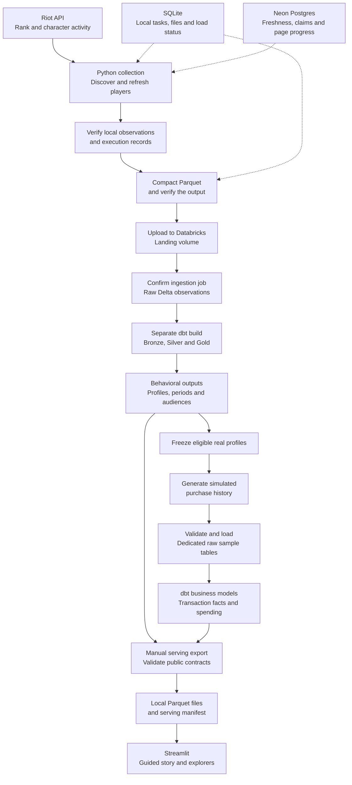

# Architecture

[Project README](../../README.md) · [Documentation index](../README.md) · [Understanding the analysis](understanding-the-analysis.md) · [Technical data models](../reference/data-models.md)

The pipeline turns repeated user observations into histories, audience profiles and comparisons that can be explored without access to the collection infrastructure. Its two source branches serve different purposes: real behavioral observations describe audiences, while **simulated purchase events** demonstrate how commercial context could be integrated. [Engineering decisions](engineering-decisions.md) explains the reasoning behind the design.

League of Legends supplies the available behavioral source. Riot's API exposes competitive status and a cumulative character activity score called mastery. Repeated observations reveal changes that a single accumulated total cannot: an old favorite may still dominate someone's history after their current interests have shifted. The warehouse retains both accumulated context and observed change.

## Follow the data

Solid arrows show the data path; dotted arrows show local execution and shared collection state. Scenario generation and dashboard export are separate manual operations. The diagram does not imply that finishing a collection cycle automatically generates purchases or refreshes the dashboard.

## Collect breadth while preserving follow-up

The collector has two jobs. Discovery visits ranked listing pages to find players and obtain observations. Refresh revisits known players so the project can retain useful history. Under a limited request allowance, collecting only new people would widen the audience while leaving little evidence about change; refreshing everyone equally would spend requests on repeatedly inactive accounts.

The Python runner adjusts the refresh allocation as weighted stale pressure rises. It reduces the contribution of repeatedly inactive players, caps the allocation and, by default, pauses discovery at that cap. This is an allocation policy rather than a measured throughput claim. Exact settings and the worked calculation are in [orchestration](../reference/orchestration.md#discovery-refresh-and-claims).

Rank listings and character-activity snapshots provide useful behavioral context without collecting every match. That choice also sets the analytical limits: the pipeline does not directly observe exact character match counts, match positions or which character produced a competitive win. Character activity can come from other game modes.

## Three stores, three responsibilities

| Store | Question it answers | Lifetime of its state |
|---|---|---|
| SQLite | Which local work ran, which files did it produce, and what happened during compaction and delivery? | The ledger remains after normal successful file cleanup. |
| Neon Postgres | Which players need attention, which work is claimed, and where should discovery continue? | Shared collection progress survives individual local runs. |
| Databricks | Which observations were ingested, and what history and analytical results do they support? | Retained warehouse data is transformed independently of temporary collection files. |

These stores are not synchronized copies. For example, the durable discovery cursor belongs in the shared registry; local file lineage belongs in SQLite. Logs and JSON reports help inspect execution without becoming another authority for task state.

Shared claims coordinate available work. They do not create a global API-key rate limiter or establish a tested deployment across multiple machines. The API client owns pacing within that client. [State ownership](../reference/orchestration.md#state-ownership) specifies these boundaries.

## Delivery has several success boundaries

Collection writes observations to local Parquet. Verification checks the work and files, compaction assembles load inputs, and another gate checks the compacted output. An uploaded file then exists in a landing volume, but that alone does not confirm that its observations reached raw tables.

The loader waits for the ingestion job before applying delivery-related freshness, load and linked page-progress updates. A separate dbt job builds the analytical interpretation. This distinction makes partial success explainable: if ingestion succeeds and dbt fails, the confirmed source delivery remains recorded while normal cleanup is blocked.

Those updates cross services and do not form one transaction. A local timeout can leave a remote job running, and an operator may need to inspect its recorded run identity before retrying. The implemented gates and retained state support diagnosis; they do not establish exactly-once processing or a completed live recovery exercise. See [failure and retry behavior](../reference/orchestration.md#failure-and-retry-behavior) for the precise rules.

## Transform observations into analytical units

The warehouse uses three layers to keep source handling separate from interpretation:

| Layer | Responsibility | Example |
|---|---|---|
| Bronze | Resolve repeated landed observations at their source-date keys. | Keep the latest ingestion for a player, queue and source date. |
| Silver | Normalize dated history, current state and reference metadata. | Distinguish a player's latest known snapshot from earlier observations. |
| Gold | Derive behavioral features, eligible periods and reusable summaries. | Describe a current audience, a player's observed rank period or a shared character audience. |

A current profile combines several kinds of evidence; it is not one perfectly synchronized measurement. Its recent character pool, accumulated activity and latest available outcome can have different support. Historical periods retain actual endpoints and eligibility rather than treating every nominal week as seven fully observed days.

dbt makes these dependencies and tests inspectable. The [data-model reference](../reference/data-models.md) owns the full model list, keys, grains, incremental behavior and missing-value contracts. [Understanding the analysis](understanding-the-analysis.md) explains what those choices mean when reading a comparison.

## Add transactions without changing their provenance

The commercial branch freezes eligible real profiles at one analytical date, then generates a purchase history for that stable cohort. Freezing prevents a later behavioral build from silently changing the people and features behind a fixed scenario. Cohort identity, configuration, seed and generator version travel together.

The generated source is produced in Python. It is not a demonstrated deployed transaction HTTP service. A dedicated loader validates files and replaces only the sample's raw tables; business models then derive transaction facts and player spending summaries. Reconciliation checks scenario identity, counts and cash totals before serving. Cash purchases remain distinct from spending in-game currency.

The resulting integration is implemented, but purchases, ownership and commercial behavior remain fictional. It demonstrates how a purchase source can join behavioral context, without establishing real demand or revenue. [Simulated transactions](simulated-transactions.md) explains the scenario; the [frozen transaction contract](../reference/data-models.md#frozen-transaction-contract) defines the boundary.

## Serve a dated result independently

The exporter queries warehouse outputs, removes operational identifiers, checks public contracts and writes Parquet files plus a manifest. Streamlit reads those local files. Viewing the bundled result requires neither source credentials nor a live warehouse connection.

That separation makes the project accessible while keeping freshness explicit. A successful collection or dbt build does not update the app's data; an operator must export again. Files are replaced individually, and selective exports can retain older unselected datasets, so the manifest's top-level timestamp is not proof of one atomic refresh.

The [serving manifest](../../streamlit_app/data/manifest.json) and [evidence reference](../reference/validation-and-evidence.md) identify the included snapshot and its checks. [Configuration](../reference/configuration.md) lists entrypoints and settings. Python coordination and manual snapshot serving are deliberate boundaries of this version; automatic publication, Airflow, Docker and infrastructure as code are outside its scope.
