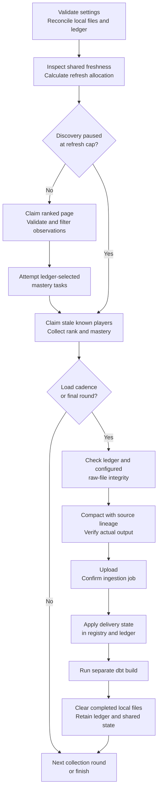

# Architecture

[Project README](../../README.md) · [Documentation index](../README.md) · [Engineering decisions](engineering-decisions.md) · [Validation and evidence](../reference/validation-and-evidence.md)

The pipeline turns repeated observations into dated histories, audience profiles and comparisons that can be explored independently of the collection infrastructure. Python decides what to collect and when work can advance; warehouse models turn the observations into analytical units; a manual export gives the dashboard its own local datasets.

League of Legends supplies the behavioral source. Riot's API exposes competitive status and cumulative character activity, called mastery. Repeated observations distinguish an accumulated favorite from a changing current interest without collecting every match. A second branch adds **simulated purchase events** to a frozen cohort of real profiles, demonstrating commercial integration while keeping its fictional origin explicit.

This chapter follows the decisions and gates in a collection cycle, then the modeling and serving boundaries. The [orchestration reference](../reference/orchestration.md) owns exact state transitions, allocation formulas and retry policies; [understanding the analysis](understanding-the-analysis.md) explains how the resulting data supports comparisons.

## Where state lives

Three stores answer different questions. Their responsibilities determine when a file can be discarded, a player can be considered fresh, or an analytical result can be rebuilt.

| Store | Question it answers | Why it persists |
|---|---|---|
| SQLite | Which local runs and tasks ran, which files did they produce, and what happened during compaction and delivery? | File lineage and load status must remain inspectable after the temporary files are removed. |
| Neon Postgres | Which players need attention, which work is claimed, and where should ranked-page discovery continue? | Shared collection progress must survive individual local runs and successful file cleanup. |
| Databricks | Which observations reached raw storage, and what history and analytical results can be built from them? | Analytical history has a longer lifetime than a local collection cycle. |

The stores hold different facts. Neon owns the durable discovery cursor; SQLite links local tasks to the files and page claims they produced; Databricks retains the observations. Logs and JSON reports describe execution without becoming another authority for task state. These boundaries keep local execution details out of analytical models while preserving enough information to explain partial success.

## Follow a collection cycle

The [Python runner](../../src/extract/run_pipeline.py) performs bounded collection rounds. It delivers accumulated files at the configured load cadence and at the final round, rather than loading after every source request.

Arrows through validation, delivery and build represent successful gates. A failed required stage stops the round and prevents normal cleanup. Dashboard export and simulated-source generation are separate manual operations after the relevant warehouse outputs exist.

### 1. Establish a trustworthy local starting point

Before collection, the runner validates settings and initializes SQLite if needed. It marks abandoned local runs failed while retaining successful task evidence, then reconciles raw files against ledger references. Unreferenced files move to quarantine; a reconciliation error stops startup.

Working directories can outlive an interrupted process, so a new invocation must distinguish retained work from files it cannot safely associate with a task. SQLite records attempts, outcomes and produced files as collection happens. Its attempt counts describe tasks, rather than every HTTP request.

### 2. Decide how much work should revisit known players

Each round begins by inspecting shared freshness for the selected region and competitive queue. The registry calculates weighted stale pressure, reducing the contribution of players whose successful checks repeatedly showed no new games in that queue. That penalty diminishes with elapsed freshness periods, so long inactivity does not permanently exclude someone.

The runner converts this pressure into a capped refresh-to-discovery scale. By default, reaching the cap pauses both ranked-page discovery and its mastery fetcher so the round can concentrate on follow-up. Below the cap, discovery runs first; the runner uses the observed page size to turn the scale into a player limit for refresh. When no nonzero page size is available, it uses the documented fallback. Configuration can keep discovery enabled at the cap.

This policy balances audience breadth against longitudinal evidence. Discovering people without revisiting them would leave little basis for describing change; repeatedly refreshing inactive people would consume the same constrained allowance. The [adaptive-allocation reference](../reference/orchestration.md#adaptive-allocation) gives the formula and a worked example. It describes scheduling behavior, not measured throughput.

### 3. Discover a page, filter observations and complete mastery work

[Discovery](../../src/extract/get_players.py) claims one ranked listing page from Neon, scoped by region, queue, tier, division and patch. Persistent cursors prevent every invocation from beginning at page one. At equal progress, traversal visits configured tiers within a division before moving to the next division, spreading a partial run across more of the configured tiers.

The collector validates the returned rank entries and filters out players already fresh in the shared registry. It also excludes recent local observations still awaiting ingestion, avoiding repeated collection while delivery is pending. Eligible rank observations are saved to partitioned Parquet and linked to their SQLite task. The mastery fetcher then attempts work selected from that local ledger within its per-round limit, including pending work and eligible older successful work.

Discovery can encounter people already known to the project. Its distinguishing feature is the ranked-page entry point. A page that produces observations keeps its claim token linked to the local task until delivery is confirmed. An empty page resets its cursor for a later traversal; a page containing only already-confirmed fresh players can advance without producing a new file. Data still pending locally cannot use that shortcut. These rules prevent page progress from silently moving past undelivered observations, while accepting that the live ranked ladder changes between visits.

### 4. Refresh known identities with new dated observations

[Refresh](../../src/extract/refresh_stale_players.py) selects stale known players through shared claims, excluding recent local work awaiting ingestion. It requests each player's current competitive status and mastery, validates the responses and writes them through the same raw-file path as discovery.

Both operations produce new dated observations. “Refresh” describes revisiting a known identity; it does not mean overwriting an earlier warehouse snapshot. Discovery broadens coverage through ranked listings, while refresh supplies follow-up even after a known player moves outside the ordinary discovery tiers.

Refresh workers renew and release the claims they own; expired claims can be reclaimed. A successful response with no entry for the tracked queue has a defined collection-state outcome without a data file. A failed request is not evidence of player inactivity. Shared claims coordinate ownership, while the API client synchronizes request pacing within that client. Neither mechanism establishes a tested deployment across multiple machines or a global limiter shared by independent API clients.

### 5. Verify inputs, compact files and verify the result

At delivery cadence, the first integrity gate checks the ledger for faulty or incomplete records. Enabling full verification adds a scan of the raw files. Failure prevents compaction.

The [compactor](../../src/extract/compact_parquets.py) merges ledger-selected files into manageable player and mastery inputs. It retains source-file lineage, checks the written temporary file and commits the completed compaction task together with the affected local record states. Compaction is therefore an inspectable transformation, rather than an unrecorded directory merge.

The [output gate](../../src/extract/verify_integrity.py) then checks the actual compacted files and their ledger links, including unreadable outputs, lost player identities and records still awaiting compaction. This gate always runs, even when the optional full raw-file scan is disabled. Valid source files alone do not establish that compaction preserved usable load inputs.

### 6. Confirm delivery, build models and release local files

The load stage refreshes character metadata and uploads compacted player and mastery files to the Databricks landing volume. The ingestion job reads landed observations into raw Delta tables. Only confirmed job success lets the loader apply delivery-related player freshness and inactivity, mark SQLite loads successful and complete eligible linked page claims.

The runner then submits a separate dbt build. Normal cleanup waits for its success and for no incomplete local loads to remain. Cleanup removes raw and compacted files while retaining SQLite and shared collection state. A successful collection-only round can therefore precede delivery; a successful ingestion can precede a failed analytical build; neither automatically updates the dashboard.

## Why delivery and build are separate

An uploaded file, an ingested observation and a successfully built model establish different facts. The [loader](../../src/load/load_compacted_to_databricks.py) waits for ingestion confirmation so the registry cannot treat undelivered observations as fresh. dbt can then fail independently while confirmed source delivery remains recorded.

| Interruption point | What remains true | What prevents normal cleanup |
|---|---|---|
| Collection or integrity fails | Successful local outputs remain available for inspection. | Required work or an integrity gate is incomplete. |
| Upload succeeds, ingestion is unconfirmed | A file may exist in the landing volume. | Raw-table delivery has not been confirmed; delivery-related state must wait. |
| Ingestion succeeds, registry or ledger updates fail | The remote source delivery succeeded. | State across the separate stores needs inspection and reconciliation. |
| Ingestion succeeds, dbt fails | Confirmed loads remain recorded. | The analytical build is incomplete. |

These writes cross services and do not form one transaction. A local wait timeout also does not establish remote cancellation: the operator must inspect the recorded run identity before retrying. The design makes partial outcomes visible through the ledger, integrity reports and remote job results. [Failure and retry behavior](../reference/orchestration.md#failure-and-retry-behavior) defines the precise handling; [validation and evidence](../reference/validation-and-evidence.md) distinguishes implemented checks from demonstrated execution evidence.

## Transform observations into analytical units

The warehouse separates source handling from interpretation:

| Layer | Responsibility | Example |
|---|---|---|
| Bronze | Resolve repeated landed observations at their source-date keys. | Keep the latest ingestion for a player, queue and source date. |
| Silver | Normalize dated history, current state and reference metadata. | Distinguish a player's latest known snapshot from earlier observations. |
| Gold | Derive behavioral features, eligible periods and reusable summaries. | Describe a current audience, a player's observed rank period or a shared character audience. |

A current profile combines several kinds of evidence; it is not one perfectly synchronized measurement. Its recent character pool, accumulated activity and latest available outcome can have different support. Historical periods retain actual endpoints and eligibility rather than treating every nominal week as seven fully observed days.

dbt exposes these dependencies and tests alongside the SQL. The [data-model reference](../reference/data-models.md) owns the full model list, keys, grains, incremental behavior and missing-value contracts. [Understanding the analysis](understanding-the-analysis.md) explains why current audiences, observed rank periods and character-attributed activity answer different questions; [metrics and methods](../reference/metrics-and-methods.md) gives their exact definitions.

## Add transactions without changing their provenance

The commercial branch freezes eligible real profiles at one analytical date, then generates a purchase history for that stable cohort. Freezing prevents a later behavioral build from silently changing the people and features behind a fixed scenario. Cohort identity, configuration, seed and generator version travel together.

Python produces the generated source. A dedicated loader validates its files and replaces only the sample's raw tables; business models then derive transaction facts and player spending summaries. Reconciliation checks scenario identity, counts and cash totals before serving. Cash purchases remain distinct from spending in-game currency.

The integration is implemented, while purchases, ownership and commercial behavior remain fictional. It demonstrates how a purchase source can join behavioral context without establishing real demand or revenue. [Simulated transactions](simulated-transactions.md) explains the scenario; the [frozen transaction contract](../reference/data-models.md#frozen-transaction-contract) defines the boundary.

## Serve a dated result independently

The exporter queries warehouse outputs, removes operational identifiers, checks public contracts and writes Parquet files plus a manifest. Streamlit reads those local files. Viewing the bundled result requires neither source credentials nor a live warehouse connection.

A successful collection or dbt build leaves this serving snapshot unchanged until an operator exports again. Files are replaced individually, and selective exports can retain older unselected datasets, so the manifest's top-level timestamp is not proof of one atomic refresh. The [serving manifest](../../streamlit_app/data/manifest.json) identifies the included snapshot; the [refresh guide](../guides/refresh-dashboard-data.md) explains candidate checks and replacement.

Readers who want to reproduce the bundled view can [run the dashboard](../guides/run-the-dashboard.md). Operating collection and warehouse delivery requires the separate services and manual prerequisites in [run the pipeline](../guides/run-the-pipeline.md). Python coordination and manual snapshot serving are deliberate boundaries of this version; automatic publication, Airflow, Docker and infrastructure as code are outside its scope.
