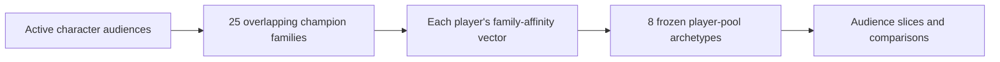

# Understanding the analysis

[Project overview](../../README.md) / [Documentation](../README.md)

The analysis asks how observed behavior can define useful audiences. Its source is League of Legends, where people choose playable characters and may participate in competitive play. The transferable problem is understanding preferences from repeated usage observations, without access to every individual event.

The dashboard develops this question in stages: describe activity, add competitive standing, compare interests, construct an audience, then inspect simulated purchases. Each stage introduces a dimension before using it in a comparison. Purchases are generated; the behavioral observations are real.

## Separate the dimensions of activity

Someone can have a long history but play infrequently now, or participate frequently in competitive play without a large accumulated activity score. Those distinctions motivate three separate measures:

| Dimension | What the story uses | Interpretation |
|---|---|---|
| Accumulated play | Lifetime character mastery, with an optional hours equivalent | A cumulative activity proxy across game modes; hours are inferred from a fixed conversion, not observed. |
| Competitive frequency | Recorded competitive wins plus losses | Participation under an annual-season assumption, not total play across all modes. |
| Retained history | Earliest retained last-play marker | A lower bound on history, not account creation or time under collection. |

Standing adds current competitive position. The saved rank reference shows how common those tiers are in the reference population; the audience's own rank distribution answers a different question. Current position does not demonstrate improvement or skill gained through a particular interest.

## From individual characters to interpretable interests

A single favorite loses secondary interests, while a list of every character is difficult to compare. The project therefore developed two distinct grouping layers:

**Champion families group characters whose audiences overlap.** Initial graph clustering supplied candidates, but a single exclusive partition could hide shared interests or force awkward placements. Full-roster and anchored searches explored alternatives; saved resampling diagnostics and member-level review supported selection of 25 overlapping families covering 173 characters. The accepted definition preserves each family's evidence and allows a character to belong to several groups.

**Player-pool archetypes summarize combinations of those family affinities.** Nonnegative matrix factorization (NMF) finds eight recurring profiles that players can express in mixtures. A player may express one component, several, or no component strongly enough for an active label: Single, Blend and Diffuse. Names such as Bruisers And Tanks and Control Mages describe these profiles; informal player feedback checked recognizability, not statistical accuracy.

Recent membership and accumulated preference are separate decisions. Existing models determine which characters belong to an active pool using recency and, once tracking history is sufficient, activity gains. Archetype features then use lifetime mastery within that pool, without requiring competitive observations. Both short-history and mature membership rules apply in the current snapshot.

The accepted transformation is frozen. Exports apply the same components and training weights to new rows; opening the dashboard never fits a model. The [family reference](../reference/character-family-cohort.md) explains selection and evidence, and the [archetype reference](../reference/player-pool-archetypes.md) specifies scoring. It also distinguishes archetype inputs from the older cutoff-based family-affinity measure.

## Use interests to ask questions, not rank popularity

A larger archetype audience is not necessarily a stronger or more meaningful preference. Family size, overlap, character popularity and the training sample all affect assignments. Loading strengths are not probabilities, and family consistency is not independent validation of the player model.

The Interests chapter therefore uses archetypes as **audience slicers**: how do people expressing different interests compare in activity, standing and other interests? Reach establishes how much evidence supports a comparison. Underlying family matrices and component profiles are available as method detail rather than a second ranking of audiences.

A comparable business application would group items by overlapping usage audiences, then describe users through mixtures of item groups. Applying that idea to sales would require actual purchase or exposure records and suitable windows; this project does not observe all sales or demonstrate recommendation performance.

## Compare within an explicit context

Guided questions compare two groups inside a stated parent audience. For example, standing groups are compared within a shared competitive-frequency band. Other traits can still differ: this is a descriptive comparison, not matching or a controlled experiment.

Combine lets a reader construct shared conditions and independent A/B selections across the introduced dimensions. Groups can overlap. Interest over/under compares each selection's share with its shared parent; it does not remove structural popularity or family-size bias. The [story contract](../reference/dashboard-story.md) owns the exact predicates and denominators.

Behavioral summaries use rank weights calibrated on the full base and retained through filtering. This adjusts the observed rank mix toward the saved reference, without repairing selection within tiers or supplying missing people. Customer summaries use unweighted scenario members. Sparse results retain their denominator but may lack a supported estimate; an unavailable measurement is not zero.

## Extend the audience to purchasing

The purchase chapter applies the same audience definition to linked customers and separates participation, spending per purchaser, purchase frequency and content acquisition. This demonstrates an identity-safe integration and coherent reporting over a second domain.

The scenario was generated from a frozen real cohort using configured relationships and randomness. Archetypes were attached later and were not generator inputs. Current interests therefore cannot be interpreted as purchase-date preferences or predictive evidence. [Simulated transactions](simulated-transactions.md) explains what was generated and how cash is counted once.

## What earlier exploration contributed

Earlier work described concentration and breadth through rule-based specialist/generalist labels, then investigated period-aligned rank movement. It helped establish the need for dated observations, explicit eligibility and distinct denominators. The default story now prioritizes the broader audience dimensions and interpretable interest mixtures; those older classifications are not the eight archetypes.

The legacy explorers retain those windows, growth comparisons and standardization tools. Historical growth results were inconclusive, and character-level outcomes were inferred rather than observed match records. Their formulas remain in [metrics and methods](../reference/metrics-and-methods.md); they are optional research depth, not prerequisites for reading the dashboard.

Continue with [Architecture](architecture.md) to see how the collection and delivery design supports these distinctions, or inspect [Validation and evidence](../reference/validation-and-evidence.md) for the accepted artifacts and measured limits.
